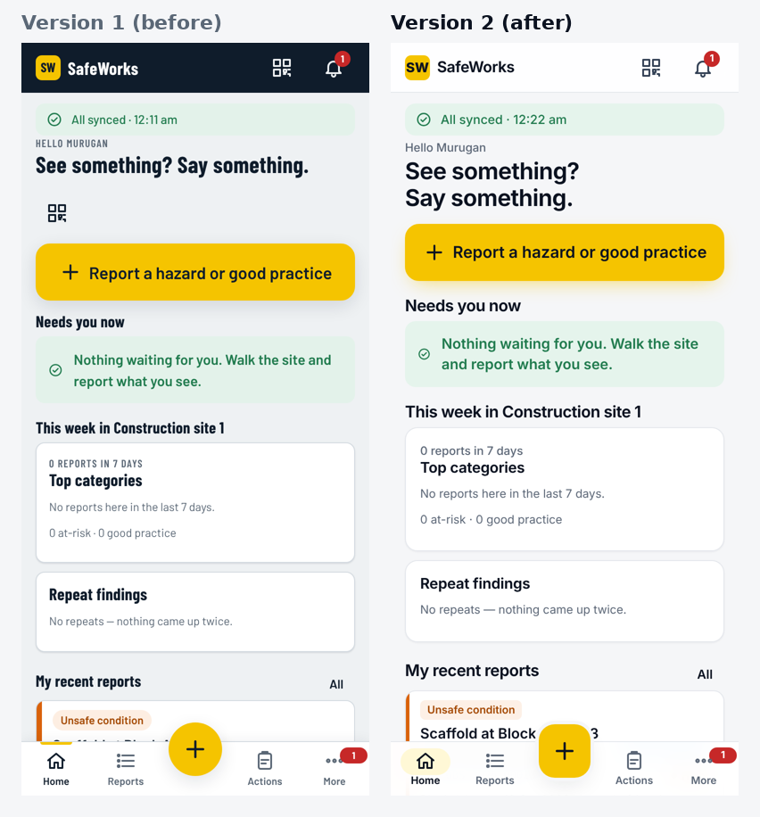
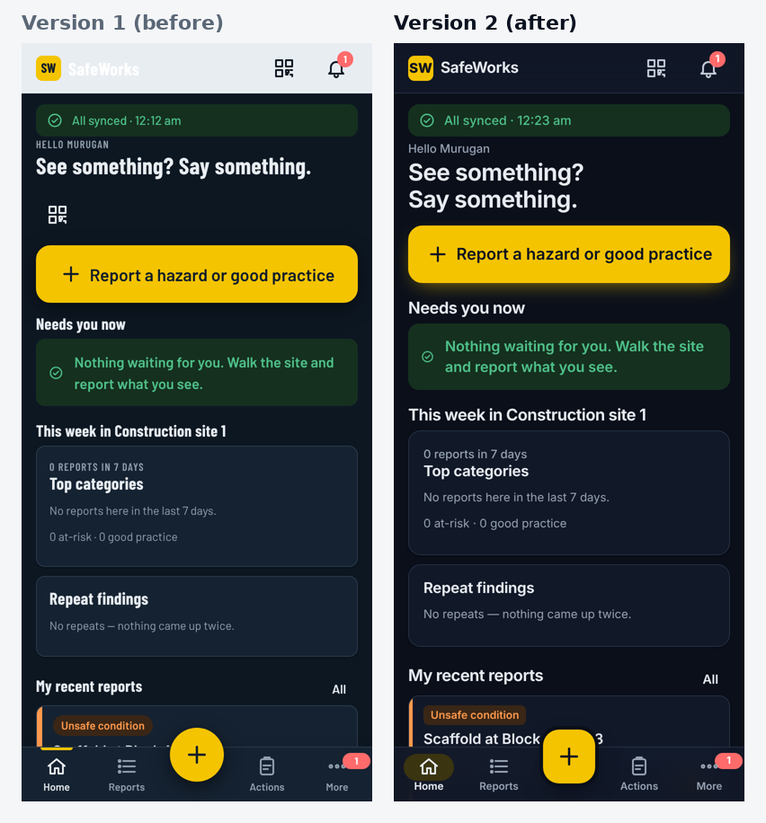
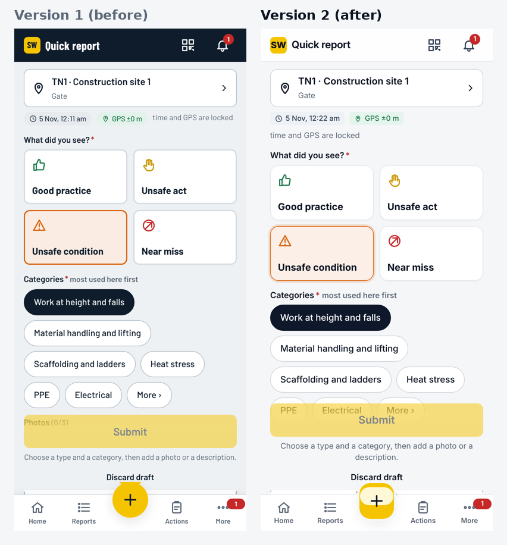
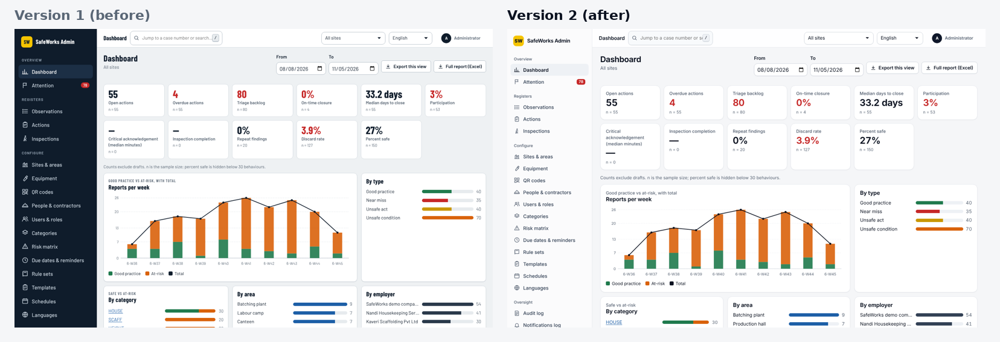
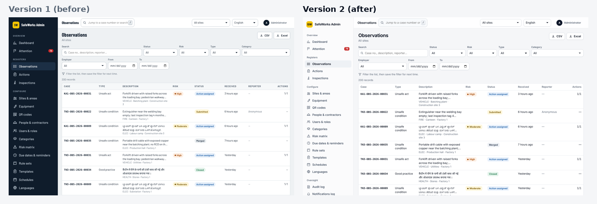

# SafeWorks UI version 2

Version 2 is a new look and feel for the phone app, the admin console and the website library. It lives on the
branch **`v2-ui-redesign`**. Version 1 stays on **`main-d2jizp`**. Both branches build, run and pass the same tests;
only the screens differ (the server, data and API are the same).

## Where the design comes from

| Source | What we took |
|---|---|
| [shadcn/ui](https://github.com/shadcn-ui/ui), the most widely recommended React design system (built on Radix UI) | Neutral palette, one dark primary colour, thin borders, 10–14 px corners, soft focus ring, badge and table styles |
| [shadcn-admin](https://github.com/satnaing/shadcn-admin) | Light grouped sidebar, quiet top bar, Ctrl/⌘+K command menu, dashboard cards with the label above the number |
| Material 3 navigation bar | Active tab shown as a tinted pill in the phone's bottom bar |
| Offline-first field-app practice | Clear sync state on every screen, big touch targets (48 px), one obvious main action |

We kept the app's own CSS design system instead of moving to Tailwind and Radix: moving would have meant rewriting
every screen and adding code to an offline phone app, for the same visual result.

## What changed

- **Type:** Inter (variable font) everywhere; headings differ by weight, not by a condensed face. Hindi, Tamil and Kannada use the phone's own Noto fonts, as before.
- **Colour:** calm neutral surfaces. Hi-vis yellow is kept for the single most important action on the phone (Report a hazard, the + button, primary buttons in the field) and the logo. The console's primary buttons are dark ink. The safety sign colours (red, orange, amber, blue, green) keep their meaning. Every text colour meets WCAG 2.1 AA (4.5:1) in light and dark mode.
- **Phone app:** light translucent top bar; bottom bar with a tinted pill for the active tab; cleaner home screen (the duplicate scan button under the headline is gone; scanning stays in the top bar).
- **Console:** light sidebar with grouped sections; a **command menu (Ctrl+K, ⌘K on a Mac, or the "Go to…" button)** that opens any page the role may use, or a case number pasted into it; calmer tables (sentence-case headers), number tiles with the label above the value, dialogs with a soft blurred backdrop.
- **Notifications (toasts):** light cards in the colour of their meaning instead of solid blocks.
- **Website library:** same tokens and font.

## Before and after

| Screen | Comparison |
|---|---|
| Phone home |  |
| Phone home, dark mode |  |
| Quick report |  |
| Console dashboard |  |
| Console observations |  |

To take fresh screenshots of either version: `DATABASE_URL=... SHOTS_DIR=/some/dir node portal/e2e/screens.cjs` (wipes that database).

## Running both versions

```
git checkout main-d2jizp       # version 1
git checkout v2-ui-redesign    # version 2
cd portal/web && npm run build # then start the server as usual (see HOSTING.md)
```
